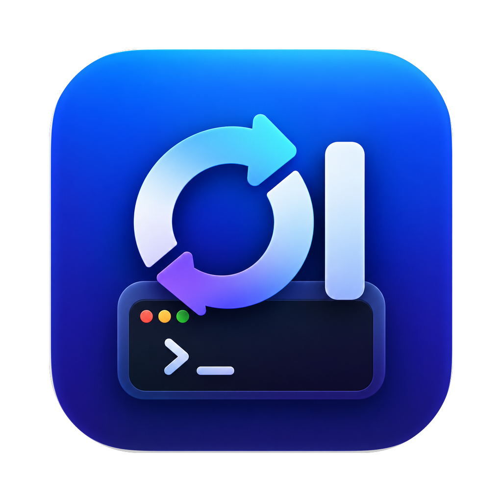

<p align="center">
  
</p>

<h1 align="center">CI Local</h1>

<p align="center">
  A macOS menu-bar app that runs your GitHub Actions on your own Mac, for free,<br>
  and keeps encrypted backups of what only lives on that Mac in any drive or cloud.
</p>

---

## Highlights

- **Free CI on hardware you already own.** No hosted minutes, no per-job cost, no billing blocks: your Mac runs the jobs, with your local caches warm between runs, so builds are often faster than on a fresh cloud VM.
- **One click from zero to runner.** Pick a private repo, and CI Local downloads, registers and starts the runner. No `config.sh` tokens or terminal steps.
- **It tells you *why* a run failed.** Billing block, lost runner or a real code failure, read from GitHub's own job annotations. It re-runs only what a re-run can fix, and never burns time re-running billing failures.
- **Migrates your workflows for you.** "Make Mac-safe" rewrites `ubuntu-*` runners and GNU-only commands and opens a pull request, listing anything it could not convert instead of failing silently.
- **Survives sleep, restarts and upgrades.** Runners come back at login and after the Mac wakes, lost jobs are re-run once, and updating the app adopts running jobs instead of killing them.
- **Disaster recovery built in.** Everything that exists only on this Mac (`.env` files, signing keys, secrets, a database dump, mirrors of your repositories on GitHub, GitLab, Bitbucket, Gitea or any Git server) goes into encrypted, versioned backups every day, with one-click restore.
- **Any drive, any cloud.** Google Drive, iCloud Drive, Dropbox, OneDrive, Box, an external or network disk, or straight to Amazon S3 (and S3-compatible R2, Wasabi, MinIO), Backblaze B2, Azure, Google Cloud Storage, SFTP, and 70+ more providers through rclone.
- **Private by design.** Backups are encrypted on the Mac before upload, secrets never enter the app's settings or logs, and nothing is sent anywhere except your Git hosts and the storage you chose.
- **Small and native.** A single SwiftUI menu-bar app with no server, no account and no dependencies beyond `gh` (and `restic` for backups).

## Why

GitHub-hosted runners cost minutes, and when an account's billing is blocked every hosted job fails in about 2 seconds with no logs. CI Local turns the Mac you already have into a **self-hosted runner** for your private repositories, manages it from the menu bar, and explains *why* a run failed instead of leaving you guessing.

## Features

### Runners
- One self-hosted runner per private repository (label `mac-local`), registered from the app with **Add repository…**.
- Starts every runner when the app opens and with **Launch at login**, so waking the Mac needs no manual step.
- Start / stop / restart per repo, open the runner log, **Re-run failed checks**.
- Upgrading the app does not interrupt running jobs: the new copy adopts runner processes that are already running.

### Runs: why did it fail?
Each failed run is classified from its job annotations:

| Kind | Meaning | What CI Local does |
| --- | --- | --- |
| **Billing** | GitHub never started the job ("recent account payments have failed") | Never re-runs it: re-running cannot help |
| **Runner lost** | The Mac slept or went offline mid-job | Re-runs once automatically when the runner is back online |
| **Code** | A real failure | Shows it; it is yours to fix |

Queued runs on merged branches are cancelled, and merged branches can be cleaned up in bulk.

### Workflows → Make Mac-safe (opens a PR)
- Switches hosted `runs-on: ubuntu-*` to `[self-hosted, mac-local]`.
- Makes GNU `sed -i 'x' f` portable for macOS.
- Adds an `if: always()` step deleting `.env` after jobs that write one (the Mac workspace persists between runs).
- Lists what it cannot fix automatically as warnings in the PR: `apt`, service containers, matrix OS, GNU-only flags, deploys that use secrets.

### Local check
Runs the repo's check script (e.g. `npm run check`) in a local clone and can install a pre-push hook.

### Backups & connections
Menu → **Backups & connections…**

- **GitHub**: shows the connected `gh` account (**Connect GitHub…** opens `gh auth login`) and can keep a mirror of **every repository** of an owner: code, branches and tags.
- **Other Git providers**: paste clone URLs from GitLab, Bitbucket, Gitea/Forgejo, Azure DevOps or any Git server (`https://…`, `ssh://…`, `git@host:path`). They are mirrored with this Mac's own Git credentials (SSH key or Keychain).
- **Where backups go**, pick one:
  - **a synced folder**, detected automatically: Google Drive, iCloud Drive, Dropbox, OneDrive, Box, or an external / network disk. The provider's app uploads it.
  - **cloud storage directly**, no desktop app needed: a [restic repository URL](https://restic.readthedocs.io/en/stable/030_preparing_a_new_repo.html) such as `s3:s3.amazonaws.com/bucket/ci`, `b2:bucket:ci`, `azure:container:/ci`, `gs:bucket:/ci`, `sftp:me@nas:/backups`, or `rclone:remote:ci` for any of rclone's 70+ providers (pCloud, Mega, WebDAV, FTP, Google Drive, OneDrive…). Credentials live in `~/.secrets/backup-cloud.env`.
- **What is saved**
  - a database dump (`pg_dump`) when a connection string is set,
  - `.env` files and signing keys (`.jks`, `.keystore`, `.p8`, `.p12`, `.mobileprovision`) found under a folder you choose (skips `node_modules`, `.git`, build output and `debug.keystore`),
  - `~/.secrets`,
  - any extra folders you add.
- **Encrypted, versioned, deduplicated** with [restic](https://restic.net): only changes are uploaded; keeps 7 daily, 4 weekly and 6 monthly snapshots.
- **Daily schedule** run by the app (catches up after sleep, retries hourly after a failure), **Back up now**, status, log and **Restore…**.
- Optional Telegram alert on failure.
- CI jobs on the same Mac can save release files:
  ```sh
  "$HOME/Library/Application Support/CI Local/backup.sh" --paths path/to/artifacts
  ```

> **Keep the backup password.** Turning backups on creates a random password in `~/.secrets/restic-backup.pass`. Copy it into your password manager: without it the backups cannot be restored, by you or anyone else.

## Requirements

- macOS 13 or later, Swift 5.9 toolchain (Xcode or Command Line Tools)
- [GitHub CLI](https://cli.github.com) signed in: `gh auth login`
- For backups: `brew install restic`; a sync app (Google Drive, Dropbox, OneDrive…) **or** cloud storage credentials; `brew install rclone` for `rclone:` destinations; and for database dumps a `pg_dump` at least as new as your server (`brew install libpq`)

## Build and install

```sh
swift test --skip LiveGitHubTests   # unit tests
./build.sh                          # builds and installs ~/Applications/CI Local.app
open ~/Applications/"CI Local.app"
```

Live GitHub tests are opt-in and use a throwaway repository you own:

```sh
CI_LOCAL_LIVE=1 swift test --filter LiveGitHubTests
```

Quitting the app from its menu stops the runners. To upgrade without interrupting a job, run `./build.sh`, send the running app `SIGTERM`, then open the new copy: it adopts the runners that are still running.

## Configuration and files

| What | Where |
| --- | --- |
| Runners | `~/Library/Application Support/CI Local/config.json` |
| Backup settings | `~/Library/Application Support/CI Local/backup.json` (exported as `backup.env` for `backup.sh`) |
| Backup status | `~/Library/Application Support/CI Local/backup-status.json` |
| Logs | `~/Library/Logs/CI Local/` |
| Database connection (optional) | `~/.secrets/database-backup.env` with `SUPABASE_DB_URL=postgresql://…` (any Postgres URL works) |
| Cloud storage keys (optional) | `~/.secrets/backup-cloud.env`, e.g. `AWS_ACCESS_KEY_ID=` / `AWS_SECRET_ACCESS_KEY=`, `B2_ACCOUNT_ID=` / `B2_ACCOUNT_KEY=`, `AZURE_ACCOUNT_NAME=` / `AZURE_ACCOUNT_KEY=`, `GOOGLE_APPLICATION_CREDENTIALS=` |
| Telegram alerts (optional) | `~/.secrets/telegram.env` with `TELEGRAM_BOT=` and `TELEGRAM_CHAT_ID=` |

## Restore

**Restore…** opens Terminal with the repository and password set, and lists the snapshots. Then, for example:

```sh
restic restore latest --target ~/Restore                 # everything
restic restore latest --target ~/Restore --include '*/.secrets'
```

Database dumps restore with `pg_restore --no-owner -d <database-url> database.dump`.

## Roadmap

- **Runners for other providers.** Runners are GitHub Actions today. GitLab CI (`gitlab-runner`), Gitea/Forgejo Actions (`act_runner`), Bitbucket Pipelines and Azure Pipelines each ship their own runner agent; the plan is one "provider" adapter per agent behind the same menu-bar controls.

## Security notes

- Self-hosted runners execute workflow code on your Mac. Use them only for **private repositories you own**: never for forks or public repos, where anyone could open a pull request that runs code on your machine.
- Backups are encrypted before they leave the Mac; your storage provider only ever sees ciphertext.
- Secrets are read from files and never stored in the app's settings or logs.
